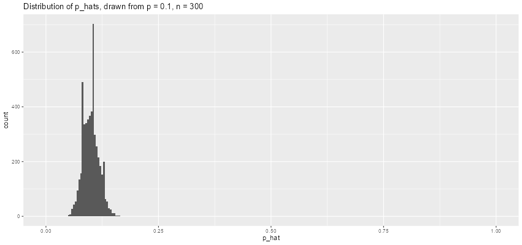

```{r global_options, include=FALSE}
knitr::opts_chunk$set(eval = TRUE, message = FALSE, warning = FALSE)
```

## Getting Started

### Load packages

In this lab, we will explore and visualize the data using the
**tidyverse** suite of packages, and perform statistical inference using
**infer**. The data can be found in the companion package for OpenIntro
resources, **openintro**.

Let's load the packages.

```{r load-packages}
library(tidyverse)
library(openintro)
library(infer)
```

```{r}
options(tibble.width = Inf)
```

### The data

You will be analyzing the same dataset as in the previous lab, where you
delved into a sample from the Youth Risk Behavior Surveillance System
(YRBSS) survey, which uses data from high schoolers to help discover
health patterns. The dataset is called `yrbss`.

1.  What are the counts within each category for the amount of days
    these students have texted while driving within the past 30 days?

**Insert your answer here**

```{r}
view(yrbss)
```

```{r}
yrbss %>%
  count(text_while_driving_30d)
```

Among the 13,583 students: 0 days = 4,792, 1-2 days = 925, 3-5 days =
493, 6-9 days = 311, 10-19 days = 373, 20-29 days = 298, all 30 days =
827, did not drive = 4,646, missing = 918.

2.  What is the proportion of people who have texted while driving every
    day in the past 30 days and never wear helmets?

**Insert your answer here**

```{r}
yrbss %>%
  filter(helmet_12m == "never") %>%
  mutate(text_ind = ifelse(text_while_driving_30d == "30", "yes", "no")) %>%
  drop_na(text_ind) %>%
  count(text_ind) %>%
  mutate(prop = n / sum(n))
```

Among non-helmet wearers with a response, 463 of 6,503 texted while
driving every day, so the proportion is about 0.071**.**

Remember that you can use `filter` to limit the dataset to just
non-helmet wearers. Here, we will name the dataset `no_helmet`.

```{r no helmet}
data('yrbss', package='openintro')
no_helmet <- yrbss %>%
  filter(helmet_12m == "never")
```

Also, it may be easier to calculate the proportion if you create a new
variable that specifies whether the individual has texted every day
while driving over the past 30 days or not. We will call this variable
`text_ind`.

```{r indicator-texting}
no_helmet <- no_helmet %>%
  mutate(text_ind = ifelse(text_while_driving_30d == "30", "yes", "no"))
```

## Inference on proportions

When summarizing the YRBSS, the Centers for Disease Control and
Prevention seeks insight into the population *parameters*. To do this,
you can answer the question, "What proportion of people in your sample
reported that they have texted while driving each day for the past 30
days?" with a statistic; while the question "What proportion of people
on earth have texted while driving each day for the past 30 days?" is
answered with an estimate of the parameter.

The inferential tools for estimating population proportion are analogous
to those used for means in the last chapter: the confidence interval and
the hypothesis test.

```{r nohelmet-text-ci}
no_helmet %>%
  drop_na(text_ind) %>% # Drop missing values
  specify(response = text_ind, success = "yes") %>%
  generate(reps = 1000, type = "bootstrap") %>%
  calculate(stat = "prop") %>%
  get_ci(level = 0.95)
```

Note that since the goal is to construct an interval estimate for a
proportion, it's necessary to both include the `success` argument within
`specify`, which accounts for the proportion of non-helmet wearers than
have consistently texted while driving the past 30 days, in this
example, and that `stat` within `calculate` is here "prop", signaling
that you are trying to do some sort of inference on a proportion.

3.  What is the margin of error for the estimate of the proportion of
    non-helmet wearers that have texted while driving each day for the
    past 30 days based on this survey?

**Insert your answer here**

```{r}
set.seed(607)
nohelmet_ci <- no_helmet %>%
  drop_na(text_ind) %>%
  specify(response = text_ind, success = "yes") %>%
  generate(reps = 1000, type = "bootstrap") %>%
  calculate(stat = "prop") %>%
  get_ci(level = 0.95)

nohelmet_ci
```

```{r}
(nohelmet_ci$upper_ci - nohelmet_ci$lower_ci) / 2
```

The 95% interval is roughly (0.065, 0.078), so the margin of error is
about 0.006.

4.  Using the `infer` package, calculate confidence intervals for two
    other categorical variables (you'll need to decide which level to
    call "success", and report the associated margins of error. Interpet
    the interval in context of the data. It may be helpful to create new
    data sets for each of the two countries first, and then use these
    data sets to construct the confidence intervals.

**Insert your answer here**

I chose the proportion of students who are Hispanic and the proportion
who sleep fewer than 5 hours on school nights.

```{r}
hispanic_ci <- yrbss %>%
  drop_na(hispanic) %>%
  specify(response = hispanic, success = "hispanic") %>%
  generate(reps = 1000, type = "bootstrap") %>%
  calculate(stat = "prop") %>%
  get_ci(level = 0.95)

sleep5_ci <- yrbss %>%
  drop_na(school_night_hours_sleep) %>%
  mutate(sleep_lt5 = ifelse(school_night_hours_sleep == "<5", "yes", "no")) %>%
  specify(response = sleep_lt5, success = "yes") %>%
  generate(reps = 1000, type = "bootstrap") %>%
  calculate(stat = "prop") %>%
  get_ci(level = 0.95)

bind_rows(hispanic = hispanic_ci, sleep_lt5 = sleep5_ci, .id = "variable") %>%
  mutate(margin_of_error = (upper_ci - lower_ci) / 2)
```

Hispanic (success = "hispanic"): $\hat{p} \approx 0.256$, 95% CI margin
of error about 0.007. We are 95% confident that between about 24.9% and
26.4% of the high schoolers in the population this survey represents are
Hispanic. Sleeps \< 5 hours on school nights (success = "\<5"):
$\hat{p} \approx 0.078$, 95% CI margin of error about 0.005. We are 95%
confident that between about 7.3% and 8.3% of these high schoolers sleep
fewer than 5 hours on school nights.

The second interval is narrower because $p$ is closer to 0, which gives
a smaller $p(1-p)$.

## How does the proportion affect the margin of error?

Imagine you've set out to survey 1000 people on two questions: are you
at least 6-feet tall? and are you left-handed? Since both of these
sample proportions were calculated from the same sample size, they
should have the same margin of error, right? Wrong! While the margin of
error does change with sample size, it is also affected by the
proportion.

Think back to the formula for the standard error:
$SE = \sqrt{p(1-p)/n}$. This is then used in the formula for the margin
of error for a 95% confidence interval:

$$ME = 1.96\times SE = 1.96\times\sqrt{p(1-p)/n} \,.$$ Since the
population proportion $p$ is in this $ME$ formula, it should make sense
that the margin of error is in some way dependent on the population
proportion. We can visualize this relationship by creating a plot of
$ME$ vs. $p$.

Since sample size is irrelevant to this discussion, let's just set it to
some value ($n = 1000$) and use this value in the following
calculations:

```{r n-for-me-plot}
n <- 1000
```

The first step is to make a variable `p` that is a sequence from 0 to 1
with each number incremented by 0.01. You can then create a variable of
the margin of error (`me`) associated with each of these values of `p`
using the familiar approximate formula ($ME = 2 \times SE$).

```{r p-me}
p <- seq(from = 0, to = 1, by = 0.01)
me <- 2 * sqrt(p * (1 - p)/n)
```

Lastly, you can plot the two variables against each other to reveal
their relationship. To do so, we need to first put these variables in a
data frame that you can call in the `ggplot` function.

```{r me-plot}
dd <- data.frame(p = p, me = me)
ggplot(data = dd, aes(x = p, y = me)) + 
  geom_line() +
  labs(x = "Population Proportion", y = "Margin of Error")
```

5.  Describe the relationship between `p` and `me`. Include the margin
    of error vs. population proportion plot you constructed in your
    answer. For a given sample size, for which value of `p` is margin of
    error maximized?

**Insert your answer here**

The relationship is a symmetric, inverted-U (parabola-like) curve. The
margin of error is 0 at $p = 0$ and $p = 1$, rises as $p$ moves toward
the middle, and is largest at $p = 0.5$, where $p(1-p)$ is maximized. So
for a fixed sample size, proportions near 0.5 are estimated least
precisely and proportions near 0 or 1 most precisely.

## Success-failure condition

We have emphasized that you must always check conditions before making
inference. For inference on proportions, the sample proportion can be
assumed to be nearly normal if it is based upon a random sample of
independent observations and if both $np \geq 10$ and
$n(1 - p) \geq 10$. This rule of thumb is easy enough to follow, but it
makes you wonder: what's so special about the number 10?

The short answer is: nothing. You could argue that you would be fine
with 9 or that you really should be using 11. What is the "best" value
for such a rule of thumb is, at least to some degree, arbitrary.
However, when $np$ and $n(1-p)$ reaches 10 the sampling distribution is
sufficiently normal to use confidence intervals and hypothesis tests
that are based on that approximation.

You can investigate the interplay between $n$ and $p$ and the shape of
the sampling distribution by using simulations. Play around with the
following app to investigate how the shape, center, and spread of the
distribution of $\hat{p}$ changes as $n$ and $p$ changes.

```{r sf-app, echo=FALSE, eval=FALSE}
library(shiny)
shinyApp(
  ui = fluidPage(
      numericInput("n", label = "Sample size:", value = 300),
      
      sliderInput("p", label = "Population proportion:",
                  min = 0, max = 1, value = 0.1, step = 0.01),
      
      numericInput("x_min", label = "Min for x-axis:", value = 0, min = 0, max = 1),
      numericInput("x_max", label = "Max for x-axis:", value = 1, min = 0, max = 1),
    plotOutput('plotOutput')
  ),
  
  server = function(input, output) { 
    output$plotOutput = renderPlot({
      pp <- data.frame(p_hat = rep(0, 5000))
      for(i in 1:5000){
        samp <- sample(c(TRUE, FALSE), input$n, replace = TRUE, 
                       prob = c(input$p, 1 - input$p))
        pp$p_hat[i] <- sum(samp == TRUE) / input$n
      }
      bw <- diff(range(pp$p_hat)) / 30
      ggplot(data = pp, aes(x = p_hat)) +
        geom_histogram(binwidth = bw) +
        xlim(input$x_min, input$x_max) +
        ggtitle(paste0("Distribution of p_hats, drawn from p = ", input$p, ", n = ", input$n))
    })
  },
  
  options = list(height = 500)
)
```

6.  Describe the sampling distribution of sample proportions at
    $n = 300$ and $p = 0.1$. Be sure to note the center, spread, and
    shape.

**Insert your answer here**



The center is at around 0.10. The spread seems to be somewhere around
0.06 and 0.14. It looks like a unimodal shape.

7.  Keep $n$ constant and change $p$. How does the shape, center, and
    spread of the sampling distribution vary as $p$ changes. You might
    want to adjust min and max for the $x$-axis for a better view of the
    distribution.

**Insert your answer here**

With n fixed at 300, the sampling distribution is always centered at
about p, so it slides along the x-axis as p changes. The spread is
largest at p = 0.5 and shrinks as p approaches 0 or 1. Near p = 0.5 the
shape is symmetric and approximately normal. As p gets small, the
distribution becomes right-skewed and is truncated at 0, and as p gets
large it becomes left-skewed.

8.  Now also change $n$. How does $n$ appear to affect the distribution
    of $\hat{p}$?

**Insert your answer here**

The center stays at $p$, but increasing $n$ makes the distribution
narrower. A larger $n$ also makes the shape more symmetric and normal,
because $np$ and $n(1-p)$ grow. A small $n$ produces a wider, lumpier,
skewed distribution, especially when $p$ is near 0 or 1.

------------------------------------------------------------------------

## More Practice

For some of the exercises below, you will conduct inference comparing
two proportions. In such cases, you have a response variable that is
categorical, and an explanatory variable that is also categorical, and
you are comparing the proportions of success of the response variable
across the levels of the explanatory variable. This means that when
using `infer`, you need to include both variables within `specify`.

9.  Is there convincing evidence that those who sleep 10+ hours per day
    are more likely to strength train every day of the week? As always,
    write out the hypotheses for any tests you conduct and outline the
    status of the conditions for inference. If you find a significant
    difference, also quantify this difference with a confidence
    interval.

**Insert your answer here**

Hypotheses: Let $p_{10+}$ be the proportion of students sleeping 10+
hours who strength train all 7 days, and $p_{<10}$ the proportion among
students sleeping fewer than 10 hours.

- $H_0: p_{10+} = p_{<10}$ sleep is unrelated to training every day
- $H_A: p_{10+} > p_{<10}$ 10+ hour sleepers are more likely to train
  every day

```{r}
sleep_strength <- yrbss %>%
  drop_na(school_night_hours_sleep, strength_training_7d) %>%
  mutate(sleep_10 = ifelse(school_night_hours_sleep == "10+", "10+", "<10"),
         strength_ind = ifelse(strength_training_7d == 7, "yes", "no"))

```

```{r}
sleep_strength %>%
  count(sleep_10, strength_ind)
```

```{r}
obs_diff <- sleep_strength %>%
  specify(strength_ind ~ sleep_10, success = "yes") %>%
  calculate(stat = "diff in props", order = c("10+", "<10"))
```

```{r}
set.seed(607)
null_dist <- sleep_strength %>%
  specify(strength_ind ~ sleep_10, success = "yes") %>%
  hypothesize(null = "independence") %>%
  generate(reps = 1000, type = "permute") %>%
  calculate(stat = "diff in props", order = c("10+", "<10"))

obs_diff
```

```{r}
null_dist %>% get_p_value(obs_stat = obs_diff, direction = "greater")
```

Conditions: The YRBSS is a random sample well under 10% of all U.S. high
schoolers, and the two groups are separate students, so independence
holds. With a pooled proportion of about 0.167, all expected counts
(about 52, 260, 1,990 and 9,917) are well above 10, so the
success-failure condition holds.

Result: 26.9% of students sleeping 10+ hours, 84 of 312, strength train
all 7 days, versus 16.4% of those sleeping less, 1,958 of 11,907, a
difference of about 0.105. No permuted difference came close, so p \<
0.001 (z ≈ 4.9). We reject H₀: there is convincing evidence that
students who sleep 10+ hours are more likely to strength train every
day.

```{r}
set.seed(607)
sleep_strength %>%
  specify(strength_ind ~ sleep_10, success = "yes") %>%
  generate(reps = 1000, type = "bootstrap") %>%
  calculate(stat = "diff in props", order = c("10+", "<10")) %>%
  get_ci(level = 0.95)
```

We are 95% confident that the proportion who strength train every day is
about 5.5 to 15.4 percentage points higher among students who sleep 10+
hours than among those who sleep less.

10. Let's say there has been no difference in likeliness to strength
    train every day of the week for those who sleep 10+ hours. What is
    the probablity that you could detect a change (at a significance
    level of 0.05) simply by chance? *Hint:* Review the definition of
    the Type 1 error.

**Insert your answer here**

If there were truly no difference, the probability of detecting one
anyway is 0.05 (5%). That is the Type I error rate, the probability of
rejecting a true null hypothesis. About 1 in 20 such studies would show
a difference purely by chance.

11. Suppose you're hired by the local government to estimate the
    proportion of residents that attend a religious service on a weekly
    basis. According to the guidelines, the estimate must have a margin
    of error no greater than 1% with 95% confidence. You have no idea
    what to expect for $p$. How many people would you have to sample to
    ensure that you are within the guidelines?\
    *Hint:* Refer to your plot of the relationship between $p$ and
    margin of error. This question does not require using a dataset.

**Insert your answer here**

With no idea what $p$ is, use the worst case $p = 0.5$, where the margin
of error is largest. We need $1.96\sqrt{0.5(0.5)/n} \leq 0.01$:

$$n \geq \frac{1.96^2 (0.5)(0.5)}{0.01^2} = 9603.04$$

We need to sample at least 9,604 people. Using this $n$, the margin of
error is at most 1% for any true p.

------------------------------------------------------------------------
